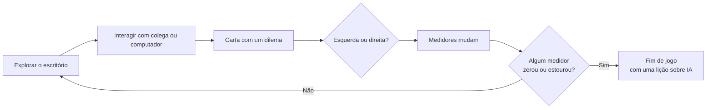
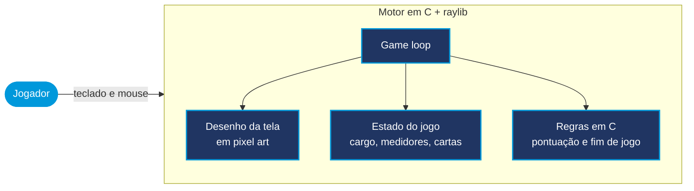

<h3 align="center">
    Você começa como estagiário numa empresa de tecnologia.
  A IA está em todo lugar. O que você faz com ela é escolha sua.
</h3>

<p align="center">
  
  
  
</p>

---

## Sobre 

O **else** é um jogo educativo sobre letramento em Inteligência Artificial. Você entra numa empresa de tecnologia como estagiário e, a cada fase, sobe um degrau na carreira até chegar a Tech Líder. Pelo caminho, a IA aparece em cada canto do escritório: na triagem de currículos, no relatório que ninguém revisou, no chatbot que atende os clientes. E é você quem decide quando usar, quando questionar e quando dizer não.

## Os quatro pilares 
Cada decisão mexe com quatro coisas ao mesmo tempo, e elas aparecem como medidores na tela durante todo o jogo.

| Pilar | A pergunta por trás |
|---|---|
| **Confiança** | Depois dessa decisão, as pessoas ainda acreditam em você e na empresa? |
| **Lucro** | Quanto vale ganhar mais se o custo cai em cima de alguém? |
| **Privacidade** | Que dados das pessoas você está entregando pra uma IA sem perceber? |
| **Viés** | A IA está tratando todo mundo do mesmo jeito? |

## Como o jogo funciona
Você explora o escritório em visão de cima, no estilo dos RPGs clássicos de 16 bits.


Se qualquer medidor chegar a 0 ou a 100, o jogo acaba. E cada final explica o que deu errado e o que isso ensina sobre IA no mundo real. Equilíbrio é tudo: lucro demais custa confiança, privacidade demais trava a empresa.

## Arquitetura

O jogo é todo feito em C com a biblioteca raylib. As regras de pontuação, as cartas e as condições de fim de jogo também ficam em C.



| Camada | Tecnologia | O que faz |
|---|---|---|
| Motor e visual | C + [raylib](https://www.raylib.com/) | Game loop, leitura de teclado e mouse, desenho das telas e controle do estado do jogo |
| Regras | C | Cálculo de pontuação, efeito das cartas nos medidores e condições de fim de jogo |

### Por que essas escolhas

- **C** é requisito do projeto, e engines comerciais (como Unity ou Godot) não são permitidas. O desafio era ter um jogo visual sem sair do C.
- **raylib** resolve isso: é uma biblioteca gráfica leve, feita pra C, que permite desenhar sprites, tocar sons e ler o teclado sem esconder a lógica do jogo atrás de uma engine.
- **Regras em C:** no início a ideia era usar Haskell para as regras, mas como a linguagem não faz parte da disciplina de PIF, a equipe decidiu manter tudo em C para simplificar o projeto.

---
## Como rodar

Baixe ou clone o repositório e abra o `jogo.exe` a partir da pasta do projeto (Windows).

<details>
<summary><b>Quero mexer no código</b></summary>

<br>

1. Instale o [MSYS2](https://www.msys2.org/) em `C:\msys64` e, no terminal **MSYS2 UCRT64**, rode:
```
   pacman -Syu
   pacman -S mingw-w64-ucrt-x86_64-gcc mingw-w64-ucrt-x86_64-raylib
```
2. Abra a pasta do projeto no VS Code e confira o compilador com `gcc --version`
3. Compile e rode com `.\jogar.bat`

Deu problema? O [Guia Rápido](./Guia_Rapido_ExecutarJogo.md) resolve os erros mais comuns.

</details>

<details>
<summary><b>Estrutura do projeto</b></summary>

<br>

```
else/
├── Code/              # código-fonte em C
├── cenario/           # imagens dos escritórios
├── Botoes/            # sprites dos botões
├── assets/            # demais imagens do jogo
├── musicas/           # trilhas sonoras
├── EfeitosSonoros/    # sons de interface
├── Documentação/      # documentos de engenharia de software
├── jogar.bat          # compila e abre o jogo
└── jogo.exe           # última versão compilada
```

</details>

---


## Documentação


Tudo o que planejamos, desenhamos e decidimos sobre o ELSE está reunido aqui. Os documentos escritos ficam na pasta [`/Documentação`](./Documenta%C3%A7%C3%A3o):

| Documento | Descrição |
|---|---|
| [Visão](./Documenta%C3%A7%C3%A3o/visao.md) | Propósito, escopo e stakeholders do produto |
| [Requisitos](./Documenta%C3%A7%C3%A3o/requisitos.md) | Requisitos funcionais, não-funcionais e restrições |
| [Histórias de Usuário](./Documenta%C3%A7%C3%A3o/historias-usuario.md) | 15 histórias no padrão 3Cs (Card, Conversation, Confirmation) |
| [Processo](./Documenta%C3%A7%C3%A3o/processo.md) | Metodologia, papéis e fluxo de trabalho da equipe |
| [Testes](./Documenta%C3%A7%C3%A3o/Estrat%C3%A9gias%20e%20Casos%20de%20Teste.md) | Estratégias, tipos de teste e critérios de aceite |
| [Modelagem e prototipação](#modelagem-e-prototipação) | Diagramas de atividade e storyboards de cada história |

---

## 📋 Gestão do projeto

Sprints, backlog e tarefas são gerenciados no board do Trello:

🔗 [Board do projeto (trello)](https://trello.com/invite/b/6ab7228e40ff14f38be9f55b/ATTIa4223772b64eccef9d08a9bf0c63c73eED83464F/else-gestao-de-sprints-squad-8)

---

## Entrega 02: Modelagem e Prototipação

**Solução de prototipação escolhida:** Storyboard

### Demonstração
> [🎬 Screencast atualizado do PIF – Equipe 8](https://youtu.be/e5QQfuGNPAU)

> [🎬 Screencast explicando cada uma das histórias de usuário do ELSE, com seus storyboards](https://youtu.be/2Ui44BgcWFU)

---

## Entrega 03: Report da Sprint 01

Nesta etapa a equipe saiu do planejamento e passou a entregar software funcionando. A Sprint 01 entregou 6 histórias de usuário jogáveis, desenvolvidas em pares, versionadas no GitHub e testadas com uma partida completa gravada em vídeo.

### Demonstração
> [🎬 Screencast dos testes da Sprint 01: partida completa mostrando cada história](LINK_DO_VIDEO)

<details>
<summary><b>Histórias implementadas na Sprint 01</b></summary>

<br>

| História | O que já funciona no jogo | Screencast do teste |
|---|---|---|
| US01: Iniciar uma nova partida | Menu inicial, tela de introdução e escritório do Estagiário com os 4 medidores em 50 | [ver](LINK) |
| US02: Tomar uma decisão e ver o impacto | Interagir com a mesa abre uma carta de dilema; escolher um lado (A/D) altera os medidores | [ver](LINK) |
| US08: Tela de fim de jogo | Quando um medidor zera ou estoura, aparece a tela de fim de jogo com música própria | [ver](LINK) |
| US09: Reiniciar a partida | Botão "Play Again" na tela de fim de jogo reinicia a partida do zero | [ver](LINK) |
| US10: Compartilhar o resultado | Botão "Share" na tela de fim de jogo salva uma imagem do resultado na pasta do jogo | [ver](LINK) |

</details>

<details>
<summary><b>Programação em pares</b></summary>

<br>

| Par | O que implementou |
|---|---|
| Igor (Almeida) + Pierre | Menu inicial, tela de introdução, movimentação do personagem com limites da sala, pause, mute e tela cheia (US01) |
| Athos + Arthur | Cartas da fase Estagiário e banco de perguntas no código (US02) |
| Pierre + Athos | Ligação das cartas com os 4 medidores, HUD e contador de dias, e integração das cartas no main (US02, US03) |
| Pierre + Caio | Condição de fim de jogo, tela de Game Over e botão Play Again (US08, US09) |
| Dani + França | Tela definitiva de Fim do Expediente, frases dos 8 finais e botão Share (US08, US10) |

</details>

<details>
<summary><b>Board da sprint e backlog</b></summary>

<br>

**Sprint 01 no board:** as 6 histórias concluídas ficam na lista *Sprint 01 · Histórias concluídas (Entrega 03 FDS)*.

<p align="center">
  
</p>

**Backlog e semanas de trabalho:** cada coluna é uma semana do projeto, do kick-off até a semana atual.


</details>

<details>
<summary><b>Testes e bugs</b></summary>

<br>

Os testes de sistema foram feitos de forma manual, jogando uma partida completa no `jogo.exe` e gravando a tela. Cada caso abaixo corresponde a uma história da Sprint 01, e o link de cada trecho do vídeo também está anexado no card da história no board, na lista Sprint 01.

| ID | História | Pré-condição | Ação | Resultado esperado | Resultado |
|---|---|---|---|---|---|
| TS01 | US01 | Jogo fechado | Abrir o `jogo.exe` e começar uma partida pelo menu | Tela de introdução e, em seguida, o escritório do Estagiário com os 4 medidores na metade | ✅ Passou |
| TS02 | US02 | Personagem perto da mesa | Apertar **E** para abrir a carta e escolher um lado com **A** ou **D** | A carta de dilema aparece e os medidores mudam conforme a escolha | ✅ Passou |
| TS03 | US03 | Partida em andamento | Tomar algumas decisões seguidas | HUD com Confiança, Viés, Privacidade e Lucro sempre visível e o contador de dias avança a cada carta resolvida | ✅ Passou |
| TS04 | US08 | Um medidor perto do limite | Escolher a opção que leva o medidor a 0 ou 100 | Tela de Fim do Expediente com a frase do final correspondente e os dias sobrevividos | ✅ Passou |
| TS05 | US09 | Tela de fim de jogo visível | Clicar em **Play Again** | A partida recomeça do zero, com medidores e dias reiniciados | ✅ Passou |
| TS06 | US10 | Tela de fim de jogo visível | Clicar em **Share** | Uma imagem `else_resultado_Ndias.png` é salva na pasta do jogo | ✅ Passou |

A estratégia geral e os casos de teste do produto completo estão em [Estratégias e Casos de Teste](./Documenta%C3%A7%C3%A3o/Estrat%C3%A9gias%20e%20Casos%20de%20Teste.md). Os bugs encontrados durante a sprint são registrados nas [Issues do repositório](https://github.com/cms7-bot/else/issues?q=label%3Abug), com a etiqueta `bug`.

</details>

---
### Modelagem e Prototipação

| Artefato | Onde encontrar |
|---|---|
| Diagramas de atividade | [FigJam](https://www.figma.com/board/3xdh1WRdeCV1OWxPhDDmk0) |
| Storyboards | [Figma](https://www.figma.com/design/jk3QiWfnkW9yzDmboFz8R9/Storyboards-Else) |
 

<details>
<summary><b>Rastreabilidade por história de usuário</b></summary>

<br>

| História | Diagrama de atividade | Storyboard |
|---|---|---|
| US01: Iniciar uma nova partida | [ver](https://www.figma.com/board/3xdh1WRdeCV1OWxPhDDmk0/US01---Iniciar-uma-nova-partida?node-id=97-563) | [ver](https://www.figma.com/design/2BYlnZ1Bia64w96XLPb5Eq/ELSE-%C2%B7-Storyboards-v2--US01-a-US15-?node-id=11-2&t=rp6Ep2IlsBj6sKU6-4) |
| US02: Tomar uma decisão e ver o impacto | [ver](https://www.figma.com/board/3xdh1WRdeCV1OWxPhDDmk0/US01---Iniciar-uma-nova-partida?node-id=100-513) | [ver](https://www.figma.com/design/2BYlnZ1Bia64w96XLPb5Eq/ELSE-%C2%B7-Storyboards-v2--US01-a-US15-?node-id=11-210&t=rp6Ep2IlsBj6sKU6-4) |
| US03: HUD e regras | [ver](https://www.figma.com/board/3xdh1WRdeCV1OWxPhDDmk0/US01---Iniciar-uma-nova-partida?node-id=101-593) | [ver](https://www.figma.com/design/2BYlnZ1Bia64w96XLPb5Eq/ELSE-%C2%B7-Storyboards-v2--US01-a-US15-?node-id=11-464&t=rp6Ep2IlsBj6sKU6-4) |
| US04: Consequências passadas | [ver](https://www.figma.com/board/3xdh1WRdeCV1OWxPhDDmk0/US01---Iniciar-uma-nova-partida?node-id=100-530) | [ver](https://www.figma.com/design/2BYlnZ1Bia64w96XLPb5Eq/ELSE-%C2%B7-Storyboards-v2--US01-a-US15-?node-id=11-736&t=rp6Ep2IlsBj6sKU6-4) |
| US05: Receber notificações inesperadas | [ver](https://www.figma.com/board/3xdh1WRdeCV1OWxPhDDmk0/US01---Iniciar-uma-nova-partida?node-id=100-537) | [ver](https://www.figma.com/design/2BYlnZ1Bia64w96XLPb5Eq/ELSE-%C2%B7-Storyboards-v2--US01-a-US15-?node-id=11-950&t=rp6Ep2IlsBj6sKU6-4) |
| US06: Aprender um conceito de IA após a decisão | [ver](https://www.figma.com/board/3xdh1WRdeCV1OWxPhDDmk0/US01---Iniciar-uma-nova-partida?node-id=100-541) | [ver](https://www.figma.com/design/2BYlnZ1Bia64w96XLPb5Eq/ELSE-%C2%B7-Storyboards-v2--US01-a-US15-?node-id=11-1202&t=rp6Ep2IlsBj6sKU6-4) |
| US07: Promoção e troca de escritório | [ver](https://www.figma.com/board/3xdh1WRdeCV1OWxPhDDmk0/US01---Iniciar-uma-nova-partida?node-id=100-548) | [ver](https://www.figma.com/design/2BYlnZ1Bia64w96XLPb5Eq/ELSE-%C2%B7-Storyboards-v2--US01-a-US15-?node-id=11-1455&t=rp6Ep2IlsBj6sKU6-4) |
| US08: Tela de fim de jogo | [ver](https://www.figma.com/board/3xdh1WRdeCV1OWxPhDDmk0/US01---Iniciar-uma-nova-partida?node-id=100-561) | [ver](https://www.figma.com/design/2BYlnZ1Bia64w96XLPb5Eq/ELSE-%C2%B7-Storyboards-v2--US01-a-US15-?node-id=11-1664&t=rp6Ep2IlsBj6sKU6-4) |
| US09: Reiniciar a partida | [ver](https://www.figma.com/board/3xdh1WRdeCV1OWxPhDDmk0/US01---Iniciar-uma-nova-partida?node-id=106-768) | [ver](https://www.figma.com/design/2BYlnZ1Bia64w96XLPb5Eq/ELSE-%C2%B7-Storyboards-v2--US01-a-US15-?node-id=11-1825&t=rp6Ep2IlsBj6sKU6-4) |
| US10: Compartilhar o resultado | [ver](https://www.figma.com/board/3xdh1WRdeCV1OWxPhDDmk0/US01---Iniciar-uma-nova-partida?node-id=109-2) | [ver](https://www.figma.com/design/2BYlnZ1Bia64w96XLPb5Eq/ELSE-%C2%B7-Storyboards-v2--US01-a-US15-?node-id=11-1932&t=rp6Ep2IlsBj6sKU6-4) |
| US11: Passar pela auditoria | [ver](https://www.figma.com/board/3xdh1WRdeCV1OWxPhDDmk0/US01---Iniciar-uma-nova-partida?node-id=106-766) | [ver](https://www.figma.com/design/2BYlnZ1Bia64w96XLPb5Eq/ELSE-%C2%B7-Storyboards-v2--US01-a-US15-?node-id=11-2001&t=rp6Ep2IlsBj6sKU6-4) |
| US12: Conversar com colegas no escritório | [ver](https://www.figma.com/board/3xdh1WRdeCV1OWxPhDDmk0/US01---Iniciar-uma-nova-partida?node-id=106-765) | [ver](https://www.figma.com/design/2BYlnZ1Bia64w96XLPb5Eq/ELSE-%C2%B7-Storyboards-v2--US01-a-US15-?node-id=11-2272&t=rp6Ep2IlsBj6sKU6-4) |
| US13: Resolver enigma da máquina de café | [ver](https://www.figma.com/board/3xdh1WRdeCV1OWxPhDDmk0/US01---Iniciar-uma-nova-partida?node-id=112-12) | [ver](https://www.figma.com/design/2BYlnZ1Bia64w96XLPb5Eq/ELSE-%C2%B7-Storyboards-v2--US01-a-US15-?node-id=11-2533&t=rp6Ep2IlsBj6sKU6-4) |
| US14: Desbloquear finais diferentes | [ver](https://www.figma.com/board/3xdh1WRdeCV1OWxPhDDmk0/US01---Iniciar-uma-nova-partida?node-id=100-585) | [ver](https://www.figma.com/design/2BYlnZ1Bia64w96XLPb5Eq/ELSE-%C2%B7-Storyboards-v2--US01-a-US15-?node-id=11-2713&t=rp6Ep2IlsBj6sKU6-4) |
| US15: Continuar de onde parei | [ver](https://www.figma.com/board/3xdh1WRdeCV1OWxPhDDmk0/US01---Iniciar-uma-nova-partida?node-id=105-746) | [ver](https://www.figma.com/design/2BYlnZ1Bia64w96XLPb5Eq/ELSE-%C2%B7-Storyboards-v2--US01-a-US15-?node-id=11-2800&t=rp6Ep2IlsBj6sKU6-4) |

</details>


